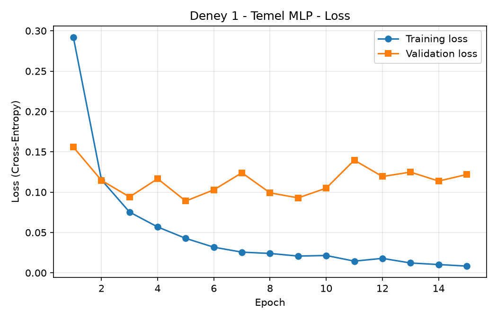
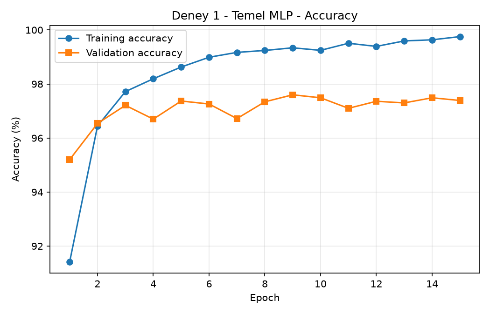
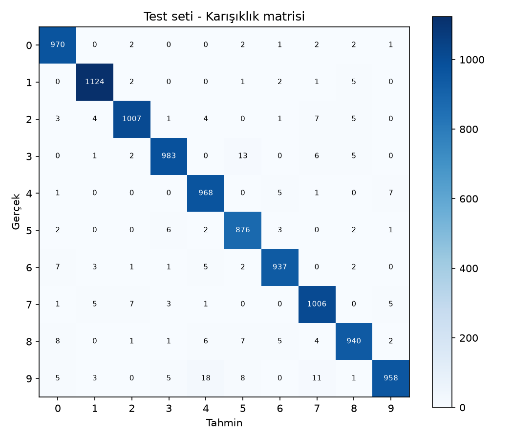
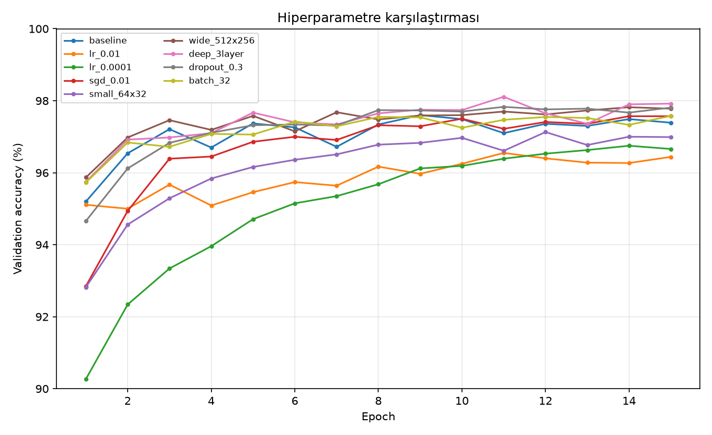
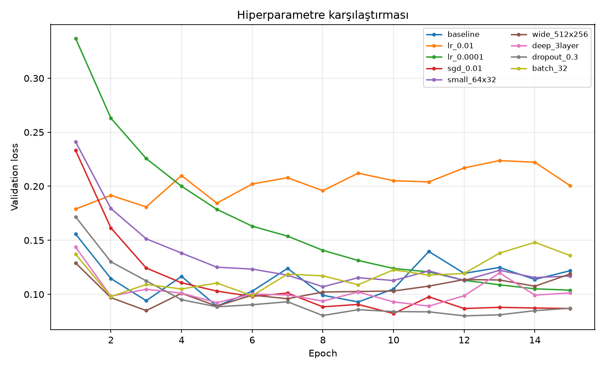
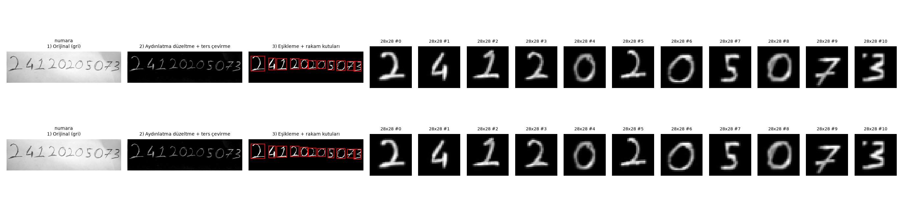
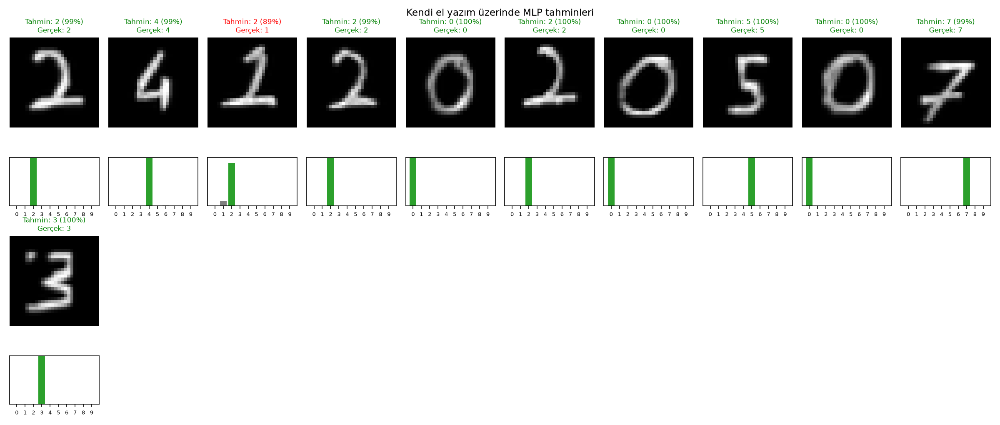
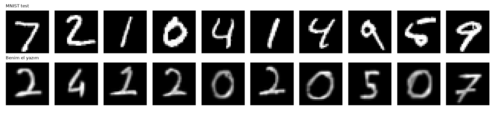

# MNIST Veri Seti ile MLP Tabanlı El Yazısı Rakam Tanıma

**Öğrenci:** _Ad Soyad_ — **Numara:** 24120205073
**Kütüphane:** PyTorch — **Model:** Multi-Layer Perceptron (CNN kullanılmamıştır)

Bu projede MNIST el yazısı rakam veri seti ile sıfırdan bir MLP eğitilmiş, farklı hiperparametre
yapılandırmaları karşılaştırılmış ve model kendi el yazımla yazdığım öğrenci numaram üzerinde test edilmiştir.


---

## 1. Proje yapısı

```
mnist-mlp/
├── common.py               # Veri yükleme (train/val/test), MLP modeli, eğitim döngüsü
├── train.py                # DENEY 1 – temel MLP modeli
├── experiments.py          # DENEY 2 – hiperparametre karşılaştırması
├── prepare_own_digits.py   # Kendi el yazısı fotoğraflarını MNIST formatına dönüştürme
├── predict_own.py          # Modeli kendi el yazım üzerinde test etme
├── requirements.txt
├── handwritten/
│   ├── raw/                # El yazısı öğrenci numarası fotoğrafları (orijinal)
│   ├── processed/          # 28x28 MNIST formatına getirilmiş rakamlar
│   └── preprocessing_steps.png
├── models/mlp_baseline.pt  # Eğitilmiş model
└── results/                # Grafikler, tablolar, JSON sonuçlar
```

## 2. Kurulum ve çalıştırma

```bash
pip install -r requirements.txt

python train.py                          # Deney 1  (CPU'da ~1-3 dk)
python experiments.py                    # Deney 2  (CPU'da ~10-20 dk)  | hızlı deneme: --quick
python prepare_own_digits.py             # handwritten/raw içindeki fotoğrafları işler
python predict_own.py --true 24120205073  # kendi numaramla test
```

MNIST veri seti ilk çalıştırmada `data/` klasörüne otomatik indirilir.

## 3. Veri seti ve train / validation / test ayrımı

MNIST: 0–9 arası rakamlar, 28×28 gri seviye görüntüler, 10 sınıf.

| Küme | Boyut | Kaynak | Kullanım amacı |
|---|---|---|---|
| Train | 50.000 | Resmi train setinin rastgele %83'ü | Ağırlıkların öğrenilmesi |
| Validation | 10.000 | Resmi train setinin kalan kısmı | Her epoch takibi, en iyi epoch ve hiperparametre seçimi |
| Test | 10.000 | Resmi test seti | Yalnızca eğitim bittikten sonra **bir kez** raporlama |

- Ayrım `torch.utils.data.random_split` ile sabit seed (42) kullanılarak yapılır, her çalıştırmada aynıdır.
- Test verisi eğitim ve model seçimi sırasında hiç kullanılmaz. En iyi ağırlıklar **validation loss**'a göre
  seçilir, test sadece bu seçilen modelle en sonda ölçülür (`common.py → run_experiment`).
- Ön işleme: `ToTensor()` (0–1 aralığı) + `Normalize(mean=0.1307, std=0.3081)`.

## 4. Deney 1 – Temel MLP modeli

### Mimari

```
Girdi 28x28 → Flatten (784)
→ Linear(784, 256) → ReLU
→ Linear(256, 128) → ReLU
→ Linear(128, 10)  → (CrossEntropyLoss içinde softmax)
Toplam eğitilebilir parametre: 235,146
```

### Hiperparametreler

| Hiperparametre | Değer |
|---|---|
| Hidden layer sayısı / boyutları | 2 — [256, 128] |
| Aktivasyon | ReLU |
| Loss | CrossEntropyLoss |
| Optimizer | Adam |
| Learning rate | 0.001 |
| Batch size | 128 |
| Epoch | 15 |
| Dropout | 0 |
| Model seçimi | En düşük validation loss |
| Seed | 42 |

### Sonuçlar (`results/baseline_results.json`)

| Metrik | Değer |
|---|---|
| Training loss (son epoch) | 0.0084 |
| Validation loss (son epoch) | 0.1218 |
| Training accuracy (son epoch) | 99.75 % |
| Validation accuracy (son epoch) | 97.39 % |
| En iyi epoch (val loss) | 5 (val loss 0.0890, val acc 97.37 %) |
| **Test accuracy** | **97.69 %** (test loss 0.0781) |
| Eğitim süresi | 215.7 sn (CPU, 15 epoch) |

### Grafikler

| Loss | Accuracy |
|---|---|
|  |  |



**Yorum:**
- Training loss 15 epoch boyunca sürekli azalmıştır (0.292 → 0.008) ve training accuracy %99.75'e çıkmıştır.
- Validation loss ise en düşük değerine **5. epoch'ta (0.089)** ulaşmış, sonra 0.09–0.14 arasında dalgalanarak
  yükselme eğilimine girmiştir. Validation accuracy %97.2–97.6 aralığında sabitlenmiştir.
- Train ile validation arasındaki bu açılma (loss: 0.008 vs 0.122, accuracy: %99.75 vs %97.39) **overfitting**
  göstergesidir: 5. epoch'tan sonra model genel kuralları değil eğitim verisinin kendisini ezberlemektedir.
- Bu nedenle test için son epoch değil, validation loss'un en düşük olduğu 5. epoch'un ağırlıkları
  kullanılmış ve test setinde **%97.69** doğruluk elde edilmiştir. Test accuracy'nin validation accuracy'ye
  çok yakın olması, validation setinin modelin gerçek performansını iyi temsil ettiğini gösterir.
- Karışıklık matrisinde hataların çoğu şekilce benzeyen rakam çiftlerinde (ör. 4↔9, 3↔5, 7↔2) toplanmaktadır.

## 5. Deney 2 – Hiperparametre karşılaştırması

Temel modelden her seferinde **tek bir** hiperparametre değiştirilmiştir (`experiments.py`).
Tablo `results/experiments.md` dosyasından kopyalanacak:

| Deney | Açıklama | Hidden | Opt. | LR | Batch | Dropout | Param. | Train loss | Val loss | Train acc | Val acc | Test acc | Süre (sn) |
|---|---|---|---|---|---|---|---|---|---|---|---|---|---|
| baseline | Temel model (Deney 1) | 256-128 | adam | 0.001 | 128 | 0.0 | 235,146 | 0.0084 | 0.1218 | 99.75% | 97.39% | 97.69% | 295.7 |
| lr_0.01 | Yüksek learning rate | 256-128 | adam | 0.01 | 128 | 0.0 | 235,146 | 0.0835 | 0.2005 | 97.95% | 96.44% | 95.45% | 265.9 |
| lr_0.0001 | Düşük learning rate | 256-128 | adam | 0.0001 | 128 | 0.0 | 235,146 | 0.0564 | 0.1039 | 98.38% | 96.66% | 97.27% | 171.6 |
| sgd_0.01 | Optimizer: SGD (momentum=0.9) | 256-128 | sgd | 0.01 | 128 | 0.0 | 235,146 | 0.0062 | 0.0869 | 99.94% | 97.57% | 97.90% | 91.1 |
| small_64x32 | Küçük hidden layer'lar | 64-32 | adam | 0.001 | 128 | 0.0 | 52,650 | 0.0255 | 0.1170 | 99.21% | 96.99% | 97.19% | 89.3 |
| wide_512x256 | Geniş hidden layer'lar | 512-256 | adam | 0.001 | 128 | 0.0 | 535,818 | 0.0112 | 0.1189 | 99.64% | 97.78% | 97.69% | 213.8 |
| deep_3layer | 3 hidden layer | 512-256-128 | adam | 0.001 | 128 | 0.0 | 567,434 | 0.0104 | 0.1013 | 99.68% | 97.92% | 98.27% | 105.5 |
| dropout_0.3 | Dropout = 0.3 | 256-128 | adam | 0.001 | 128 | 0.3 | 235,146 | 0.0451 | 0.0871 | 98.53% | 97.81% | 97.96% | 99.1 |
| batch_32 | Batch size = 32 | 256-128 | adam | 0.001 | 32 | 0.0 | 235,146 | 0.0173 | 0.1359 | 99.47% | 97.58% | 97.29% | 147.3 |

Validation accuracy'ye göre en iyi yapılandırma: **deep_3layer** (val acc 98.11%, test acc 98.27%)




> Not: Süreler aynı CPU'da ölçülmüştür ancak bilgisayarın o anki yüküne göre değişebilir (temel model
> `train.py` ile 215.7 sn, `experiments.py` içinde 295.7 sn sürmüştür). Süre karşılaştırmaları yaklaşık kabul edilmelidir.

**Yorumlar:**

- **Learning rate = 0.01 (yüksek):** En kötü sonuç (test %95.45). En iyi validation loss 1. epoch'ta görülmüş,
  sonrasında val loss 0.18–0.22 arasında dalgalanıp hiç iyileşmemiştir. Adımlar çok büyük olduğu için
  optimizasyon minimum etrafında salınmaktadır.
- **Learning rate = 0.0001 (düşük):** Eğitim kararlı fakat yavaştır; validation loss 15. epoch'ta hâlâ
  düşmektedir (en iyi epoch = 15). Train–val farkı küçüktür, yani overfitting yoktur; model henüz tam
  öğrenmemiştir (underfitting). Daha fazla epoch ile temel modele yetişmesi beklenir.
- **SGD (momentum 0.9, lr 0.01):** İlk epoch'ta Adam'dan yavaş başlamış (%86 vs %91) ama düzenli
  yakınsamış; en iyi val loss 0.082 ile Adam'lı temel modelden daha iyi, test %97.90.
- **Küçük model (64-32):** Parametre sayısı 4.5 kat daha az (52.650) olmasına rağmen test %97.19 ile temel
  modelin yalnızca ~0.5 puan gerisindedir. Kapasite azaldığı için doğruluk biraz düşmüş, ama overfitting de azalmıştır.
- **Geniş model (512-256):** Test doğruluğu temel modelle aynıdır (%97.69); en iyi epoch 3'tür, yani
  fazla parametre modelin daha erken overfit etmesine yol açmıştır. Genişlik tek başına fayda sağlamamıştır.
- **3 hidden layer (512-256-128):** En yüksek validation accuracy (%98.11) ve test accuracy (**%98.27**).
  Ek katman, daha karmaşık özellik kombinasyonları öğrenmeyi sağlamıştır.
- **Dropout 0.3:** Training accuracy daha düşük (%98.53) ama train–validation farkı en küçük olan
  deneydir (98.53 vs 97.81) ve validation loss en düşük seviyede (≈0.080) kalmıştır. Dropout overfitting'i
  azaltan bir regularization yöntemi olarak beklendiği gibi çalışmıştır (test %97.96).
- **Batch size = 32:** Epoch başına 4 kat daha fazla güncelleme yapılır; model 2. epoch'ta en iyi val
  loss'a ulaşıp sonra hızla overfit etmiştir (val loss 0.148'e kadar çıkmıştır). Test %97.29.

**Sonuç:** Tüm makul yapılandırmalar %97–98 aralığındadır; MNIST'te MLP için asıl sınırlayıcı etken
overfitting'dir. Bu nedenle validation'a göre en iyi epoch'u seçmek, dropout ve uygun learning rate
kullanmak model boyutunu büyütmekten daha etkilidir. Validation'a göre en iyi yapılandırma 3 hidden layer'lı modeldir.

## 6. Kendi el yazımla test (öğrenci numarası)

### Görüntülerin hazırlanması (`prepare_own_digits.py`)

Numaram beyaz kâğıda kurşun kalemle yazılıp telefonla fotoğraflanmış, fotoğraf yatay okunacak şekilde döndürülmüştür (`handwritten/raw/numara.jpg`).
MNIST formatına uyum için uygulanan adımlar:

1. **Gri tonlama** – renkli fotoğraf tek kanala çevrilir.
2. **Aydınlatma düzeltme** – büyük yarıçaplı Gaussian blur ile arka plan tahmin edilip görüntü buna bölünür (gölgeler silinir).
3. **Renk ters çevirme** – MNIST'teki gibi **siyah arka plan, beyaz rakam**.
4. **Otsu eşikleme** ile rakam/arka plan ayrımı, küçük lekelerin temizlenmesi.
5. **Bağlı bileşen analizi** ile rakamların bulunması ve soldan sağa sıralanması.
6. **Kalem kalınlığı ayarı** – ince kalem çizgileri MNIST çizgi kalınlığına yaklaştırılır.
7. **Yeniden boyutlandırma** – en-boy oranı korunarak 20×20 kutuya sığdırma, 28×28 tuvale yerleştirme.
8. **Kütle merkezine göre ortalama** (MNIST'in kendi hazırlanış yöntemi).
9. **Normalizasyon** – piksel/255, ardından eğitimdeki ile aynı `(x − 0.1307) / 0.3081`.



### Sonuçlar (`results/own_handwriting_results.md`)

| Görüntü | Gerçek | Tahmin | Doğru rakam | Rakam doğruluğu |
|---|---|---|---|---|
| numara | 24120205073 | 24220205073 | 10/11 | 91% |

**Toplam rakam doğruluğu: 10/11 = 90.9%**

- 11 rakamın **10'u doğru** tahmin edilmiştir (**%90.9**). Doğru tahminlerin hepsinde model %99–100 güvenle karar vermiştir.
- Tek hata 3. rakamdır: **1**, %89 güvenle **2** olarak tahmin edilmiştir (1 sınıfına yalnızca küçük bir olasılık verilmiştir).
  Rakamı Türkiye'de yaygın olduğu gibi **alt çizgili ve üstte şapkalı** yazdım. Bu şekil, sol üstte kıvrım ve
  altta yatay çizgisiyle MNIST'teki 2'lere benzemektedir. MNIST'teki 1'ler ise çoğunlukla tek bir düz dikey çubuktur.
- 7'yi ortası çizgili yazmama rağmen model doğru tanımıştır; 3'ün yanındaki küçük kalem lekesi de sonucu bozmamıştır.




## 7. Genel değerlendirme

_(Kendi sonuçlarınıza göre düzenleyin.)_

- MLP, MNIST test setinde temel modelle **%97.69**, en iyi yapılandırmayla (3 hidden layer) **%98.27** doğruluğa ulaşmıştır. CNN kullanılmadan, sadece tam bağlı
  katmanlarla bu kadar yüksek başarı MNIST'in görece kolay ve "temiz" bir veri seti olmasından kaynaklanır.
- Kendi el yazımda doğruluk **%90.9** (11 rakamdan 10'u) olmuştur, yani MNIST test başarısından (%97.69) **daha düşüktür**. Bunun nedeni
  **distribution shift**'tir: kalem kalınlığı, yazım stili, fotoğraf ışığı, kâğıt dokusu ve ortalama/ölçekleme
  farkları modelin eğitimde gördüğü dağılımdan farklıdır.
- MLP görüntüyü 784 bağımsız piksel olarak görür; uzamsal yapıyı (komşu pikseller) bilmez. Bu yüzden
  rakam birkaç piksel kaydığında, eğik yazıldığında veya kalınlığı değiştiğinde tahmin kolayca bozulur.
  Ön işlemedeki ortalama ve kalınlık ayarının sonucu bu yüzden çok etkiler.
- Modelin yanıldığı tek rakam **1** oldu (2 olarak tahmin edildi). Türkiye'de 1'e şapka ve alt çizgi konulması,
  MNIST'teki (ağırlıklı olarak Amerikan yazım stilindeki) düz çubuk şeklindeki 1'lerden farklıdır. Model bu yazım stilini
  eğitimde neredeyse hiç görmediği için en yakın gördüğü sınıf olan 2'ye atamıştır. Bu, **distribution shift**'in somut bir örneğidir.
- Ön işlemenin önemi: İlk denemede bir kalem izi ayrı bir rakam sanıldı ve 12 rakam bulundu. Tahminler bir sıra kaydığı için
  doğruluk %45'e düştü. Segmentasyon düzeltilince doğruluk %90.9'a çıktı. Gerçek dünya verisinde başarı, modelin yanında
  verinin eğitim formatına ne kadar iyi dönüştürüldüğüne de bağlıdır.
- İyileştirme önerileri: veri artırma (döndürme, kaydırma, kalınlık değişimi), dropout, daha fazla
  çeşitli el yazısı verisi, ya da uzamsal bilgiyi kullanan CNN mimarileri.
